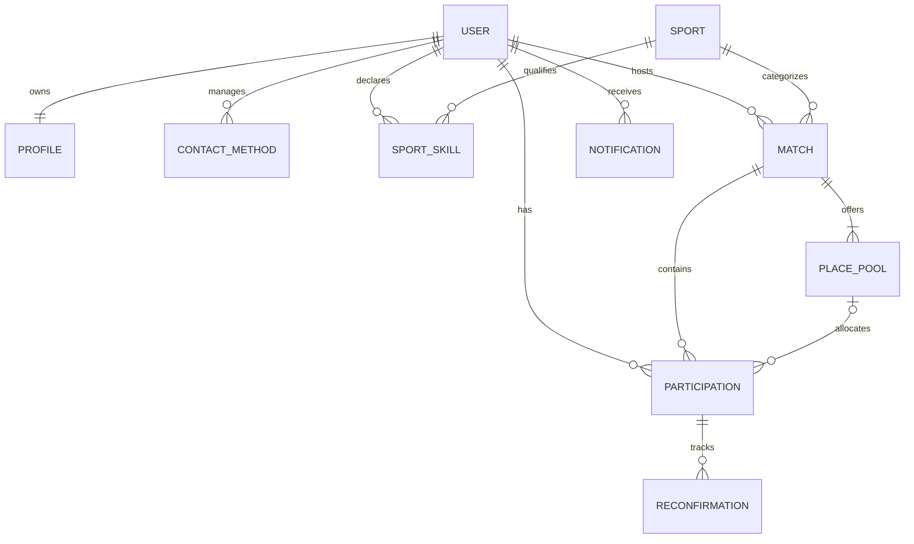
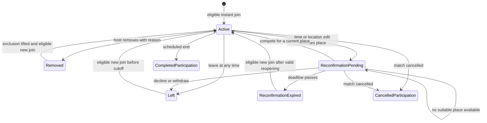

# Domain model

This is a **Derived recommendation selected under DEC-060**. It is a logical model,
not a vendor schema or implementation. Supabase is now selected under
[DEC-061](../decisions/decision-log.md#dec-061); the entities and invariants here
remain the contract for the [derived backend mapping](technical-overview.md).

## Terms and entities

| Term | Meaning and boundaries |
|---|---|
| User | Account that owns profile choices and participation; guest viewers have no account requirement for public contact access |
| Profile | Public name, sport skills, relevant roles and upcoming matches only; no avatar |
| ContactMethod | Owner's phone, email, WhatsApp, or Telegram identifier, with explicit public visibility; independent of login identity |
| Sport | Match category from a searchable list or custom entry |
| SportSkill | Self-declared Beginner/Intermediate/Advanced for one user and sport |
| Match | Host, sport, location, scheduled time, admission deadline, eligibility, status and current details revision |
| PlacePool | General or host-named playing-role capacity; mixed pools are supported |
| Participation | One person's relationship to one match and current playing allocation, if any |
| Reconfirmation | A request to accept a revised time/location; holds no place |
| Removal | Host action with recorded reason and match-specific rejoin exclusion; host may lift exclusion; reason private to host and removed player |
| Notification | Private in-app service event for an affected account; no participant conversation content |
| AuditEvent | Proposed record of consequential changes without duplicating raw contact values |

A host is an authority associated with the match. A playing host also has a
participation allocation; a non-playing host does not. A person is never counted
twice because they are both host and player.

## Logical relationships

One host and one active allocation per person/match are selected derived defaults.
Optional host participation and playing-only occupancy are directly Confirmed.
No ContactGrant entity belongs in the current model.

## Participation state and occupancy

| State | Occupies a place? | Meaning |
|---|---|---|
| None | No | No current participation |
| Active | Yes | Successful join/reconfirmation against current details |
| Reconfirmation pending | No | Prior place released after time/location edit; may try to return |
| Left | No | User withdrew; contacts remain governed by profile settings |
| Removed | No | Host removed the person with a recorded reason |
| Reconfirmation expired | No | No successful reconfirmation by the deadline |
| Cancelled participation | No active place | Terminal state; internal details retained at most 30 days |
| Completed participation | No active place | Scheduled end reached; no public past-history list |

Proposed state names can change without changing behavior. Reconfirmation pending
must never be counted as an occupied or reserved place.

Host removal prevents rejoining until the host explicitly lifts the exclusion.
Lifting it permits a normal admission attempt, not automatic reinstatement.
Complete automatically at end. Terminal links expose state only; details/rosters
expire after 30 days. No public past-history lists. Leaving while participation is
active must not be converted into an admission cutoff.

## Match lifecycle and availability

**Selected representation:** publication/lifecycle status is distinct from computed
availability. For example, a published match can be full, have places, or have
admission closed. Full is not a terminal lifecycle state.

Admission requires a joinable lifecycle state, current time before the adopted
deadline, available capacity, sign-in, and current eligibility. A cancelled match
cannot admit a player. Automatic completion and state-only terminal pages follow DEC-043/050; retention
follows DEC-054. Lock time/location at start; never reopen a terminal match.

No cross-match overlap check is performed. Scheduling data is used to present the
match and enforce its own deadline, not to prevent simultaneous commitments.

## Invariants and transactions — Derived recommendations

1. Occupancy equals active playing allocations, including a playing host, excluding
   non-playing hosts and pending reconfirmations.
2. Total and role occupancy do not exceed their capacities. One person has at most
   one current allocation per match.
3. Joining/reconfirming checks the current revision and allocates atomically.
4. Time/location editing atomically releases allocations, marks previous players
   pending, updates details/revision, and installs a valid future deadline no later
   than the revised start.
5. Capacity/role/skill edits commit only if all current players still fit. Host
   removal is a separate explicit action, not a hidden side effect.
6. Reconfirmation expiry closes only the corresponding pending revision. It never
   releases a place twice or removes a newer successful reconfirmation.
7. A leave releases an existing allocation once, including after admission closes.
8. Profile publication is owner-controlled and independent of match participation.
9. Notification retries do not duplicate service events.
10. Deadline checks use an authoritative clock. Strictly-before admission at the
    boundary is the selected derived default under DEC-060.

## Data that must not be conflated

- Authentication email and optional publicly displayed email.
- Host authority and playing occupancy.
- Current self-declared skill and any proposed admission snapshot used for history.
- In-app service notifications and external participant conversations.
- Public contact publication and private recipient consent.
- Match revision, notification read state, and successful reconfirmation.
- Historical participation evidence and current capacity.

The [requirements](../product/requirements.md) are the behavioral source of truth;
revise this model with future decisions. Account deletion immediately removes
personal data and withdraws/cancels all unfinished participation/hosting. Retained
records must not preserve deleted personal data.
