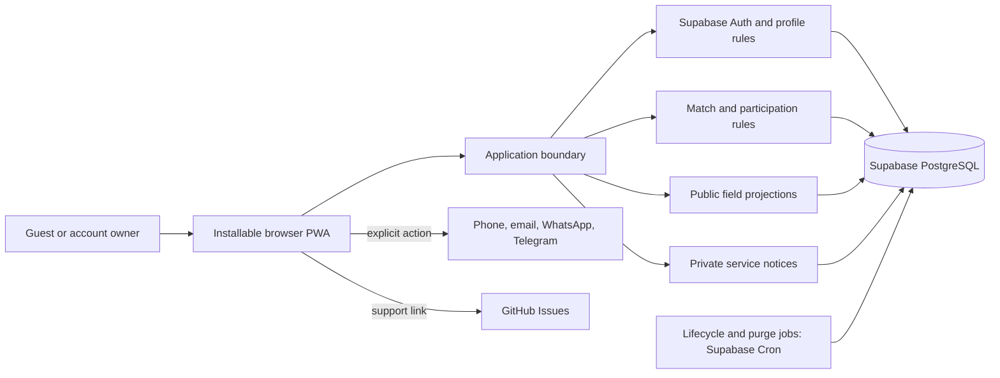

# Supabase MVP architecture

## Status and boundary

Supabase is the **Confirmed** backend selection in
[DEC-061](../decisions/decision-log.md#dec-061), sourced to the owner's
[selection](../sources/conversation-evidence.md#src-030). It supersedes
DEC-055's vendor deferral for the backend only. Frontend framework/hosting,
map/geocoding provider, SMTP vendor and deployment region remain **Open**.

The logical controls below remain **Derived recommendations selected under
DEC-060**. Their Supabase mapping is a **Derived recommendation** from the selected
backend and existing requirements, not an explicit owner selection of every module.
Targeting hosted Supabase Free is a **Derived recommendation** from the
[free-cloud research request](../sources/conversation-evidence.md#src-029).
Free-plan suitability is unresolved; no paid plan, resources or spending are approved.

The fixed constraints are an installable PWA, online-only match data/actions,
email/password without verification, password reset by email, public selected
contacts, external chat, atomic instant admission, private in-app notices,
scheduled lifecycle and immediate deletion/30-day retention.

## Logical components

Use one product application with clear modules and the managed backend. The
diagram's Supabase modules are the recommended mapping; no resources exist yet.

## Recommended Supabase mapping

**Status: Derived recommendation.** The mechanisms implement the existing product
rules; they do not add features or change the domain model.

| Need | Recommended mechanism | Boundary |
|---|---|---|
| Durable relational state | Supabase PostgreSQL | Preserve the [domain invariants](domain-model.md); a hosted database alone does not enforce them |
| Email/password and recovery | Supabase Auth | Disable Confirm Email to preserve DEC-045; custom SMTP needed for public reset delivery, vendor still Open |
| Map/distance discovery | PostGIS extension | Geographic distance/filtering; map rendering, geocoding and their costs remain separate |
| Atomic match actions | Database functions called through the API (RPC) | Each business transition owns one database transaction with locking, authorization and retry rules |
| Public/private access | Row Level Security (RLS), least-privilege grants and explicit field projections | RLS filters rows; it does not by itself hide private columns |
| Completion and purge | Supabase Cron (`pg_cron`) calling idempotent database jobs | Reads/writes enforce time rules even if a job is late; paused hosting cannot be treated as running jobs |

Official capability references are in the [source register](../sources/external-references.md#supabase-technical).
Storage uploads, Realtime subscriptions and an Edge Function layer are not required
merely because Supabase offers them. Add trusted server handling where an operation
needs privileged Auth access, such as account deletion; never put admin credentials
in the browser. The service-notice list remains private and in-app only.

## Responsibilities

| Component | Contract |
|---|---|
| Identity/profile | Email/password, private reset flow, owner edits, public display projection, deletion |
| Sport/location | Stable sport IDs plus custom entries; host-defined roles; coordinates and venue time zone |
| Match/participation | Authoritative join/leave/switch/edit/remove/cancel/reconfirm; no approval or overlap checks |
| Public projection | Current selected methods and approved public fields; terminal pages expose state only |
| Service events | Durable affected-user events and private read/unread list, without contact copies |
| Scheduled work | Admission expiry, completion, retention purge and restore/deletion protection |
| External boundary | Deliberate contact launch/copy and GitHub support; no conversation or report ingestion |

No native messaging service, moderation dashboard, payment/booking integration,
private-game authorization or waitlist worker belongs in MVP.

## Transaction and revision rules

A successful admission must atomically check account/exclusion, current skill,
place pool, lifecycle, revision and authoritative deadline, then allocate once.
Use unique participation constraints and idempotent commands or an equivalent
mechanism. Concurrent joins/reconfirmations compete for the same inventory.

**Supabase mapping — Derived recommendation:** implement each admission, role switch
and material edit as one database-function transaction. Serialize competing changes
on the match and its place pools with a consistent locking order; after acquiring
the lock, recheck revision, eligibility and current server time before mutation.
All capacity-changing paths, including host actions, must follow the same protocol.
Several client API calls are separate transactions and cannot provide this guarantee.
RLS alone is not a capacity or revision check.

A time/location edit before start validates any accompanying capacity/role/skill
change against the current roster, installs a new revision and future cutoff,
releases allocations and marks eligible former participants pending in one logical
transaction. Pending records reserve no place. Stale confirmations/expiry jobs
must not mutate newer participation.

Role switching transfers allocation atomically; failure preserves the old place.
Compatible host edits cannot race with admission to produce overcapacity. Leaving
releases at most one allocation and never automatically reopens admission.

Persist service events with their state change or use an equivalent durable
outbox. Idempotent delivery avoids duplicate notices. A worker being late must not
extend a deadline: reads/writes apply the authoritative time rule immediately.

## Public/private projections and caches

Guest responses may include public names, relevant skill/roles, exact active match
location, upcoming lists and owner-selected contacts. They exclude login/reset
data, hidden contacts, removal reasons and private notices. A host gains removal
authority, not access to a participant's unpublished contact methods.

**Supabase mapping — Derived recommendation:** keep raw identity/contact data behind
protected tables and expose explicit public projections. Do not grant anonymous
read access to an entire profile row that also stores private fields. Review direct
table access, view permissions and function execution separately; a safe UI query
does not stop a caller from making a broader API request. See the
[authorization controls](security-and-nonfunctional.md#supabase-access-controls).

Terminal pages expose only ended/cancelled state, including API/HTML/prefetch
payloads. Contact settings remain independent on the person's profile.

Require fresh authorized projections; invalidate app-controlled publication caches
before acknowledging hide/edit/delete. Cache only static assets/offline shell.
No contact-bearing or match-data offline browsing, queued writes or stale-page
success claims. Reconcile uncertain requests after reconnection.

## Time, location and lifecycle

Store absolute instants plus the venue's IANA time zone and coordinates. Support
global locations; English/Spanish/Dutch display uses match-local time with explicit zone.
Resolve clock-change ambiguity explicitly. The join/reconfirm/switch cutoff is
exclusive; time/location locks at start; automatic completion occurs at end.

At 30 days after terminal state, purge details and roster, retaining only an
opaque ID/state marker for terminal links. Notices purge after 30 days from creation.
Account deletion immediately removes active personal data and all unfinished
participation/hosting; purge/anonymize related personal fields.

Use restore protection so old backups cannot resurrect deleted accounts. Any
minimal erasure journal contains only restoration keys, no profile/contact content,
and is bounded by the backup window. Backups expire within 30 days. Provider choice
must support these constraints; deployment cannot silently weaken them.

## Hosted Free feasibility and release gates

**Open:** hosted Free is the cost target, not a verified operating plan. Current
[quotas and pausing/backup policies](../sources/external-references.md#supabase-free-hosting)
must be checked against realistic pilot usage. Low-activity pausing stops the
application from relying on continuous database jobs. Paused data can remain
recoverable beyond the confirmed 30-day retention window. This is an unresolved
deployment conflict in [Q-019](../planning/open-questions.md#q-019), not permission
to relax [DEC-054](../decisions/decision-log.md#dec-054).

Public launch also needs working reset-email delivery through custom SMTP;
[Q-020](../planning/open-questions.md#q-020) tracks provider, sender/domain and
delivery setup. Disabling confirmation does not remove the password-reset need.
No assurance of an entirely free MVP follows from the backend's Free plan: frontend,
maps, domain/email and recovery operations must be evaluated separately.

## Implementation decisions deliberately deferred

Frontend framework/hosting, map/geocoding, SMTP vendor, region, deployment resources,
schema/migrations, concrete recovery/load targets and a retention-compatible hosting
configuration require a later implementation task. Supabase selection resolves the
backend vendor only. Evaluate deployment choices against the fixed browser,
privacy, retention and transactional requirements; any paid option needs a separate
decision.

This package creates no credentials, provider resources, product code, schema
migrations, deployments or spending commitments.
