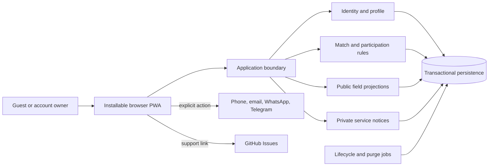

# Technology-neutral architecture

## Status and boundary

Technology neutrality is **Confirmed** in DEC-055. The logical architecture here
is a **Derived recommendation selected under DEC-060**. No language, framework,
database vendor, authentication service, map provider, SMTP or hosting platform
is selected. Next.js/Supabase references record investigated options, not adoption.

The fixed constraints are an installable PWA, online-only match data/actions,
email/password without verification, password reset by email, public selected
contacts, external chat, atomic instant admission, private in-app notices,
scheduled lifecycle and immediate deletion/30-day retention.

## Logical components

Start with one deployable application and clear modules. This is a selected default,
not a recovered rejection of microservices or a vendor architecture commitment.

## Responsibilities

| Component | Contract |
|---|---|
| Identity/profile | Email/password, private reset flow, owner edits, public display projection, deletion |
| Sport/location | Stable sport IDs plus custom entries; host-defined roles; coordinates and venue time zone |
| Match/participation | Authoritative join/leave/switch/edit/remove/cancel/reconfirm; no approval or overlap checks |
| Public projection | Current selected methods and approved public fields; terminal pages expose state only |
| Service events | Durable affected-user events and private read/unread list, without contact copies |
| Scheduled work | Admission expiry, completion, retention purge and restore/deletion protection |
| External boundary | Deliberate contact launch/copy and GitHub support; no conversation or report ingestion |

No native messaging service, moderation dashboard, payment/booking integration,
private-game authorization or waitlist worker belongs in MVP.

## Transaction and revision rules

A successful admission must atomically check account/exclusion, current skill,
place pool, lifecycle, revision and authoritative deadline, then allocate once.
Use unique participation constraints and idempotent commands or an equivalent
mechanism. Concurrent joins/reconfirmations compete for the same inventory.

A time/location edit before start validates any accompanying capacity/role/skill
change against the current roster, installs a new revision and future cutoff,
releases allocations and marks eligible former participants pending in one logical
transaction. Pending records reserve no place. Stale confirmations/expiry jobs
must not mutate newer participation.

Role switching transfers allocation atomically; failure preserves the old place.
Compatible host edits cannot race with admission to produce overcapacity. Leaving
releases at most one allocation and never automatically reopens admission.

Persist service events with their state change or use an equivalent durable
outbox. Idempotent delivery avoids duplicate notices. A worker being late must not
extend a deadline: reads/writes apply the authoritative time rule immediately.

## Public/private projections and caches

Guest responses may include public names, relevant skill/roles, exact active match
location, upcoming lists and owner-selected contacts. They exclude login/reset
data, hidden contacts, removal reasons and private notices. A host gains removal
authority, not access to a participant's unpublished contact methods.

Terminal pages expose only ended/cancelled state, including API/HTML/prefetch
payloads. Contact settings remain independent on the person's profile.

Require fresh authorized projections; invalidate app-controlled publication caches
before acknowledging hide/edit/delete. Cache only static assets/offline shell.
No contact-bearing or match-data offline browsing, queued writes or stale-page
success claims. Reconcile uncertain requests after reconnection.

## Time, location and lifecycle

Store absolute instants plus the venue's IANA time zone and coordinates. Support
global locations; English/Spanish display uses match-local time with explicit zone.
Resolve clock-change ambiguity explicitly. The join/reconfirm/switch cutoff is
exclusive; time/location locks at start; automatic completion occurs at end.

At 30 days after terminal state, purge details and roster, retaining only an
opaque ID/state marker for terminal links. Notices purge after 30 days from creation.
Account deletion immediately removes active personal data and all unfinished
participation/hosting; purge/anonymize related personal fields.

Use restore protection so old backups cannot resurrect deleted accounts. Any
minimal erasure journal contains only restoration keys, no profile/contact content,
and is bounded by the backup window. Backups expire within 30 days. Provider choice
must support these constraints; deployment cannot silently weaken them.

## Implementation decisions deliberately deferred

Stack, database implementation, map/geocoding, identity/SMTP, hosting, deployment
resources, cost ceilings and concrete recovery/load targets require a later
implementation task. Evaluate current capabilities against the fixed browser,
privacy, retention and transactional requirements.

This package creates no credentials, provider resources, product code, schema
migrations, deployments or spending commitments.
